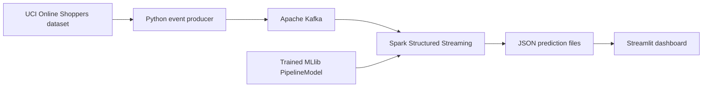

# Real-Time E-Commerce Analytics & Customer Purchase Prediction

[GitHub repository](https://github.com/vivekkrs/Real-Time-E-Commerce-Analytics-Customer-Purchase-Prediction-Platform)

An end-to-end analytics demo that replays online shopping sessions through Kafka, scores events with a PySpark MLlib model, and displays results in a Streamlit dashboard.

## Architecture



The producer replays historical dataset rows as events. The Spark Kafka connector reads the topic and scores events with a persisted model. Spark writes append-only JSON output with checkpointing; the dashboard reads those output files.

## Technology

- Apache Kafka and `kafka-python` for event transport
- PySpark RDDs, DataFrames, and Spark SQL for batch analytics
- PySpark MLlib pipeline with a Random Forest classifier
- Spark Structured Streaming for Kafka ingestion and model scoring
- Streamlit and Plotly for the dashboard
- Docker Compose for the end-to-end stack

## Quick start with Docker

Requirements: Docker Desktop with Compose and an internet connection for the first image build and Spark Kafka connector download.

```powershell
docker compose up --build -d
docker compose ps
```

The first launch trains the model before starting the streaming scorer. Follow progress with `docker compose logs -f model-trainer`; open the dashboard at [http://localhost:8501](http://localhost:8501). Stop the services with:

```powershell
docker compose down
```

Model files and Spark checkpoints are generated locally and are not committed.

## Local development

Requirements: Python 3.10+ and Java 17. On Windows, local Spark also needs a Hadoop `winutils` setup; Docker is the recommended option when that is unavailable.

```powershell
python -m venv .venv
.\.venv\Scripts\Activate.ps1
python -m pip install -r requirements.txt
python src/ml/train.py
```

Start Kafka with `docker compose up -d kafka`, then run each command in its own terminal:

```powershell
python src/producer/kafka_producer.py --rate 0.8
python src/streaming/spark_streaming.py
streamlit run dashboard/app.py
```

The producer and scorer use `localhost:9092` by default. Override the broker with `KAFKA_BOOTSTRAP`, and the topic with `KAFKA_TOPIC`. To replay a finite number of events, pass `--limit`, for example `--limit 100`.

Run batch analytics and tests from the repository root:

```powershell
python src/analytics/01_rdd_analytics.py
python src/analytics/02_spark_sql_analytics.py
python src/ml/clustering.py
python -m pytest
```

## Repository layout

```text
dashboard/       Streamlit dashboard
data/raw/        UCI source dataset
data/processed/  Batch analytics and model evaluation summaries
docs/            Project report
notebooks/       Exploratory Spark notebook
src/analytics/   RDD and Spark SQL jobs
src/ml/          Model training and clustering
src/producer/    Kafka event producer
src/streaming/   Kafka-to-Spark scoring pipeline
tests/           Project tests
Notes.md         Setup guide and project defense notes
```

## Dataset and results

The source data is the [Online Shoppers Purchasing Intention Dataset](https://archive.ics.uci.edu/dataset/468/online+shoppers+purchasing+intention+dataset) from the UCI Machine Learning Repository (12,330 sessions). The included `data/processed/model_metrics.json` records a sample evaluation; rerun model training to regenerate metrics for the current environment and split.

The checked-in batch summaries and model metrics are example outputs. Live predictions, the trained model, and streaming checkpoints are generated at runtime.
