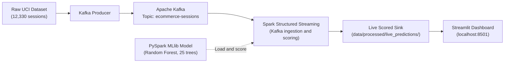

# Real-Time E-Commerce Analytics & Customer Purchase Prediction Platform

[GitHub repository](https://github.com/vivekkrs/Real-Time-E-Commerce-Analytics-Customer-Purchase-Prediction-Platform)

A distributed analytics platform that replays online shopping sessions through Kafka, scores events with a PySpark MLlib model, and presents purchase predictions in a Streamlit dashboard.

---

## 🏗️ Architecture



The producer replays historical dataset rows as events. Spark reads the Kafka topic, loads the trained pipeline model, and appends predictions to JSON output files with checkpointed Kafka offsets. The dashboard reads those files and refreshes the live metrics and session feed.

---

## 🛠️ Technology Stack

| Layer | Technologies | Purpose |
| :--- | :--- | :--- |
| **Ingestion** | Apache Kafka, `kafka-python` | Event transport between the producer and Spark |
| **Batch Foundations** | PySpark RDDs | Low-level transformations such as `map`, `filter`, and `reduceByKey` |
| **Structured Analytics** | PySpark DataFrames, Spark SQL | Aggregations, Catalyst optimization, and window functions |
| **Machine Learning** | PySpark MLlib | Feature pipeline and Random Forest purchase prediction |
| **Stream Processing** | Spark Structured Streaming | Kafka ingestion, micro-batch scoring, and checkpointed output |
| **Presentation** | Streamlit, Plotly | Auto-refreshing metrics, visualizations, and scored-session feed |
| **Orchestration** | Docker, Docker Compose | Multi-service deployment, including model training |

---

## 🎯 Model Performance & Key Findings

The checked-in `data/processed/model_metrics.json` contains a sample evaluation from a seeded 80/20 train/test split. Its test set contains 2,418 sessions; retraining can produce run-specific metrics.

- **ROC-AUC:** `0.9174`
- **PR-AUC:** `0.7530`
- **Accuracy:** `90.20%`
- **F1-score:** `0.8908`
- Sessions with `PageValues > 50` convert at **81.13%** (331 of 408 sessions).
- New visitors convert at **24.91%**, compared with **13.93%** for returning visitors.

---

## 🚀 Quick Start

### Option 1: Docker (Recommended)

Requirements: Docker Desktop with Docker Compose and an internet connection for the image build and first Spark Kafka connector download.

```powershell
docker compose up --build -d
docker compose ps
```

Compose trains the model before starting the streaming scorer. Follow the initial training with `docker compose logs -f model-trainer`, then open the dashboard at [http://localhost:8501](http://localhost:8501). To inspect scoring logs or stop the stack:

```powershell
docker compose logs -f streaming
docker compose down
```

The trained model, live prediction files, and Spark checkpoints are generated locally and are not committed.

### Option 2: Local Step-by-Step Run (PowerShell)

Requirements: Python 3.10+ and Java 17. On Windows, local Spark also requires Hadoop `winutils` configuration; use the Docker option if that is unavailable.

From the repository root, create the environment, install dependencies, and train the model:

```powershell
python -m venv .venv
.\.venv\Scripts\Activate.ps1
python -m pip install -r requirements.txt
python src/ml/train.py
```

Start Kafka in one terminal:

```powershell
docker compose up -d kafka
```

Then run the producer, scorer, and dashboard in three separate terminals, with the virtual environment activated in each:

```powershell
python src/producer/kafka_producer.py --rate 0.8
```

```powershell
python src/streaming/spark_streaming.py
```

```powershell
streamlit run dashboard/app.py
```

The local producer and scorer use `localhost:9092` and topic `ecommerce-sessions` by default. Configure `KAFKA_BOOTSTRAP` or `KAFKA_TOPIC` to use different values. Add `--limit 100` to the producer command to replay a finite number of events.

Run the batch analytics and tests from the repository root:

```powershell
python src/analytics/01_rdd_analytics.py
python src/analytics/02_spark_sql_analytics.py
python src/ml/clustering.py
python -m pytest
```

---

## 📂 Repository Structure

```text
Real-Time-E-Commerce-Analytics-Customer-Purchase-Prediction-Platform/
├── dashboard/
│   └── app.py                         # Streamlit and Plotly dashboard
├── data/
│   ├── processed/
│   │   ├── batch_monthly_summary.csv  # Spark SQL monthly summary
│   │   ├── cluster_metrics.json       # Sample K-Means evaluation
│   │   ├── cluster_profile.csv        # Sample visitor-cluster profile
│   │   └── model_metrics.json         # Sample Random Forest evaluation
│   └── raw/
│       └── online_shoppers_intention.csv
├── docs/
│   └── project_report.md
├── notebooks/
│   └── exploratory_analysis.ipynb
├── src/
│   ├── analytics/
│   │   ├── 01_rdd_analytics.py
│   │   └── 02_spark_sql_analytics.py
│   ├── ml/
│   │   ├── clustering.py
│   │   └── train.py
│   ├── producer/
│   │   └── kafka_producer.py
│   └── streaming/
│       └── spark_streaming.py
├── tests/
│   └── test_pipeline.py
├── .dockerignore
├── .gitignore
├── docker-compose.yml
├── Dockerfile
├── Notes.md
└── requirements.txt
```

`models/spark_purchase_model/`, `data/processed/live_predictions/`, and `checkpoints/live_predictions/` are created at runtime and intentionally excluded from version control.

---

## Dataset

The raw data is the [Online Shoppers Purchasing Intention Dataset](https://archive.ics.uci.edu/dataset/468/online+shoppers+purchasing+intention+dataset) from the UCI Machine Learning Repository. It contains 12,330 sessions and is included under `data/raw/`.
